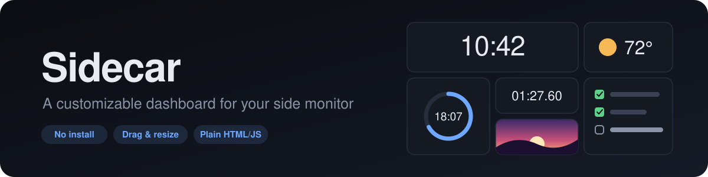
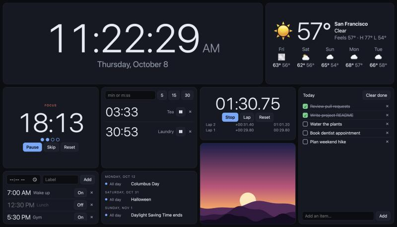
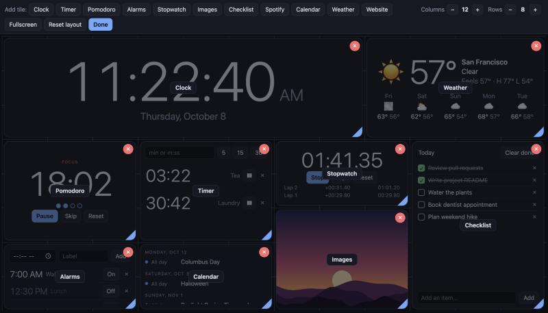

<p align="center">
  
</p>

<p align="center">
  <b>Turn a spare monitor into an always-on dashboard.</b><br>
  Drag, resize and mix tiles until it fits your screen. Plain HTML, CSS and JavaScript, with no build step.
</p>

<p align="center">
  <a href="#-quick-start">Quick start</a> ·
  <a href="#-tiles">Tiles</a> ·
  <a href="#-make-it-yours">Customize</a> ·
  <a href="#-connected-tiles">Spotify &amp; Calendar setup</a> ·
  <a href="#-build-your-own-tile">Build a tile</a>
</p>

<p align="center">
  
</p>

## 🚀 Quick start

**On a Mac:** download this repository, then double-click `start.command`.

That's it. It uses the Ruby that ships with macOS, so there is nothing to install. The dashboard opens at
`http://127.0.0.1:8080`. Keep the Terminal window open while you use it.

**On Windows or Linux:** install [Ruby](https://www.ruby-lang.org), then run:

```bash
ruby server.rb
```

and open `http://127.0.0.1:8080` in your browser.

## 🧩 Tiles

| | Tile | What it does |
|:-:|---|---|
| 🕐 | **Clock** | Big clock with the date. 12 or 24 hour, with or without seconds. |
| ⏳ | **Timer** | Several countdowns at once. Type minutes or pick a preset. |
| 🍅 | **Pomodoro** | Focus and break cycles with adjustable lengths and a long break every fourth round. |
| ⏰ | **Alarms** | Daily alarms that flash the tile and ring until dismissed. |
| ⏱️ | **Stopwatch** | Hundredths of a second, with lap times. |
| 🖼️ | **Images** | Drop in photos for a single picture or a slideshow. |
| ✅ | **Checklist** | A simple to-do list with a title you can rename. |
| 🎵 | **Spotify** | Now playing with album art, plus play, pause and skip. |
| 📅 | **Calendar** | A read-only agenda of your Google Calendar events. |
| 🌤️ | **Weather** | Current conditions and a five-day forecast for any city. |
| 🌐 | **Website** | Embed another site or a YouTube video. |

Every tile can be added more than once, so you can have two checklists or several website embeds.

## 🎨 Make it yours

Click **Edit** in the bottom-right corner.

<p align="center">
  
</p>

| To… | Do this |
|---|---|
| Move a tile | Drag it anywhere on the grid |
| Resize a tile | Drag the blue corner at its bottom-right |
| Remove a tile | Click the red × |
| Add a tile | Pick one from the bar at the top |
| Fit a different screen | Change the number of **Columns** and **Rows** |
| Fill the monitor | Click **Fullscreen** |

The layout stretches to fill whatever screen it is on, landscape or portrait, and everything is saved
automatically. Timers and the stopwatch keep counting through a page refresh.

## 🔌 Connected tiles

<details>
<summary><b>🎵 Spotify</b> (one-time setup, about 5 minutes)</summary>

<br>

1. Create an app at [developer.spotify.com/dashboard](https://developer.spotify.com/dashboard).
2. Set its Redirect URI to `http://127.0.0.1:8080/` and tick **Web API**.
3. Paste the app's **Client ID** into the Spotify tile and click **Connect**.

Showing what's playing works on any account. The play, pause and skip buttons need Spotify Premium.

</details>

<details>
<summary><b>📅 Google Calendar</b> (about 1 minute per calendar)</summary>

<br>

1. In Google Calendar, open **Settings** and click your calendar's name in the left sidebar.
2. Under **Integrate calendar**, copy the **Secret address in iCal format**.
3. Paste it into the Calendar tile and click **Add**. Repeat for each calendar you want to see.

Treat that address like a password: anyone who has it can read the calendar.

</details>

<details>
<summary><b>🌤️ Weather</b> (no setup)</summary>

<br>

Type a city and pick it from the results. Forecasts come from [Open-Meteo](https://open-meteo.com),
which needs no account or key.

</details>

<details>
<summary><b>🌐 Website</b> (no setup)</summary>

<br>

Paste any link. Normal YouTube links are converted to their embeddable form automatically. Some sites
refuse to be shown inside other pages, and the tile stays blank for those.

</details>

## 🔒 Your data stays on your computer

Your layout, checklist items, alarms, images, Spotify login and calendar addresses are stored in your
browser, not in this folder. The local server only listens on your own machine. To reset everything,
clear the browser's site data for `127.0.0.1:8080`.

## 🛠️ Build your own tile

Each tile is a single self-contained file in `js/tiles/`. A minimal one looks like this:

```js
(function () {
  const { h } = Dash;
  Dash.registerTile({
    type: 'hello',
    name: 'Hello',
    defaultSize: { w: 3, h: 2 },
    create(ctx) {
      ctx.el.append(h('div', { class: 'center' }, 'Hello, world'));
    },
  });
})();
```

Add a `<script>` line for it in `index.html` and it appears in the edit bar. The full tile API
(saved state, timers, alerts, file storage) is described in [`CLAUDE.md`](CLAUDE.md).

## 📁 Project layout

```
index.html        page shell, lists one script per tile
server.rb         tiny local server (also fetches calendar feeds)
start.command     double-click launcher for macOS
css/style.css     theme and tile styles
js/core.js        grid, edit mode, storage, sound
js/tiles/         one file per tile
```
